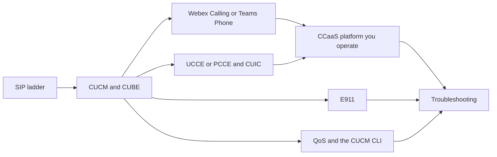
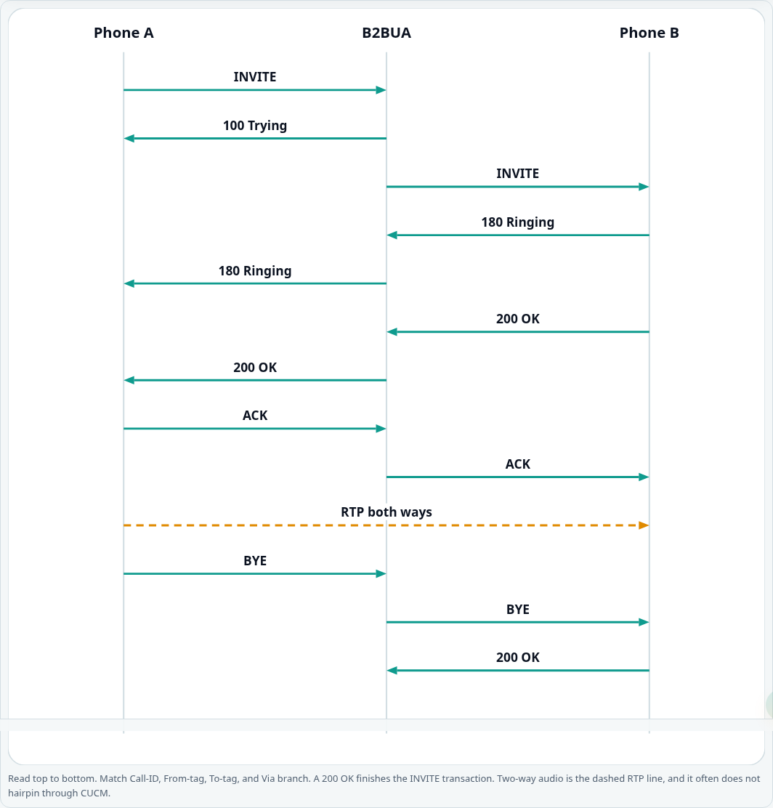
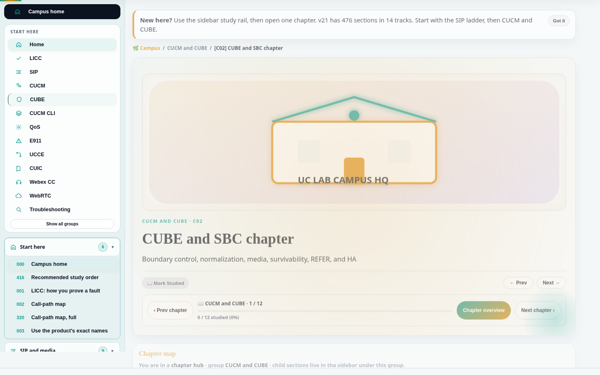
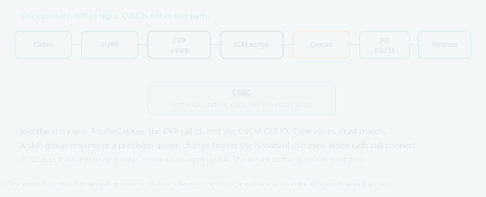
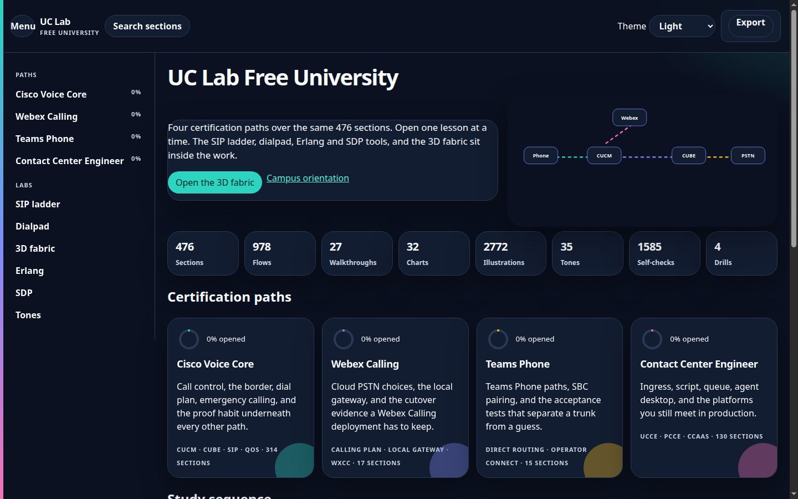

  

  
  &nbsp;
  

A free offline campus for people who run **voice, unified communications, and contact center** systems. The file is the course: CUCM, CUBE, SIP, Webex Calling, Webex Contact Center, Teams Phone, UCCE, PCCE, CUIC, the main CCaaS platforms, E911, QoS, and the troubleshooting habit that ties them together.

Built by **CYPHER0X9**, a voice and UC engineer. Version **21**. One HTML file. No account, no install, no CDN.

  

## Tracks

| Track | Sections | You can do this when you finish |
|---|---:|---|
| Start here | 6 | Explain a call with leg, identifier, counter, and capture |
| SIP and media | 9 | Read a ladder and separate signaling from RTP |
| CUCM and CUBE | 12 | Trace CSS, route pattern, dial-peer, and the SIP trunk |
| Webex Calling and Teams Phone | 17 | Choose Calling Plan, Operator Connect, Direct Routing, or a local gateway, then prove it |
| Contact center — UCCE and PCCE | 6 | Trace ingress, CVP, script, queue, Finesse, and CUIC |
| CCaaS and UCaaS platforms | 105 | Follow a contact on Webex CC, Connect, Genesys, NICE, Five9, Flex, and the platforms you still meet |
| Emergency calling | 3 | Prove location, ELIN or ERL, and the on-site notification |
| Voice network and QoS | 16 | Mark and measure EF, use the CUCM CLI, and explain WebRTC only for browser agents |
| Migrations | 61 | Dual-run a number, rehearse rollback, and leave evidence |
| Troubleshooting | 112 | One hypothesis, one change, one evidence pack |
| Evidence habits | 33 | Write the proof before you touch production |
| Design notes | 35 | Read capacity, identity, recording, and failure domains |
| Practice | 56 | Drill the same faults without a customer on the line |
| Reference | 5 | Open the glossary and the official-doc index |

476 sections in the sidebar. The old bulk practicums, trading-turret track, Asterisk course, and generic machine-learning chapter are not in this edition.

## Study order

## Diagrams inside the file

  

  

  

## Open it

1. **Download (v21):** [releases/uc-lab-free-university.html.zip](./releases/uc-lab-free-university.html.zip)
2. Unzip. The file inside is `uc-lab-free-university.html`.
3. **Open** it in Chrome, Safari, Edge, or Firefox. From this repo, the same campus is [campus/uc-lab-free-university.html](./campus/uc-lab-free-university.html).

Desktop is the comfortable way to read it. A phone works in the full browser app after the file loads. In-app browsers from chat apps often fail on a file this size.

| Also in the repo | What it is |
|---|---|
| [62-slide briefing](./downloads/Enterprise-Voice-with-Cisco-Technologies-CC-Cloud-Migration.pptx) | Enterprise voice, contact center, and cloud migration |
| [How to get the file](./HOW-TO-GET.md) | Phone and desktop steps |
| [Start here](./START-HERE.md) | First hour |
| [How to use it](./docs/HOW-TO-USE.md) | A 30-day path, interview prep, and a class plan |
| [FAQ](./docs/FAQ.md) | What this is, and what it is not |
| [Session vault, Oct 2026](./docs/references/uc-contact-center-session-vault-2026-10.md) | Public conference and doc links |

## Two topics that look out of place

**WebRTC** stays because contact-center agent desktops and web soft clients send media from the browser. It is not a separate product track.

**Linux** stays as the CUCM command line. CUCM, Unity Connection, IM and Presence, and Emergency Responder run on Cisco VOS. You use that shell to check NTP, replication, certificates, and disk. It is not a Linux administration course.

## Proof habit

| Letter | Meaning | Question |
|---|---|---|
| L | Leg | Which hop failed? |
| I | Identifier | Which Call-ID, RouterCallKey, or interaction id joins the logs? |
| C | Counter | Which platform counter moved? |
| C | Capture | Which ladder, packet capture, CLI output, or CUIC interval proves it? |

## Light and dark

  

The palette is teal `#0F9B8E` on navy `#0B1220`, with amber for media and warnings. The header theme control switches light and dark. Nothing is loaded from a CDN.

## License

Educational material under the [MIT license](./LICENSE). Not an official Cisco, Microsoft, Google, Amazon, or Genesys publication. Check the vendor's current document before you change production.

**CYPHER0X9** · [github.com/cipher0x9](https://github.com/cipher0x9)
