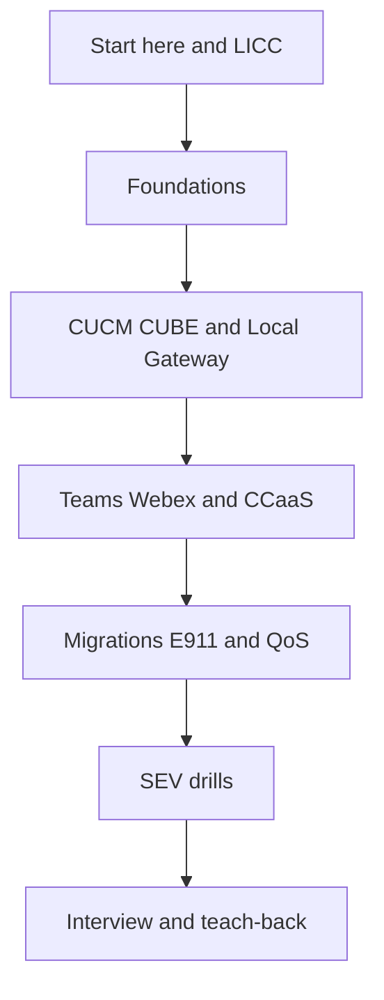

<p align="center">
  
</p>

<h1 align="center">🌿 UC Lab Free University</h1>

<p align="center">
  <strong>A free offline campus for Voice, Unified Communications, and Contact Center.</strong><br/>
  One HTML file · 632 sections · LICC proof habit · Cisco, Webex, Teams, and CCaaS
</p>

<p align="center">
  <a href="./releases/uc-lab-free-university.html.zip"></a>
  <a href="./campus/uc-lab-free-university.html"></a>
  <a href="https://github.com/cipher0x9/ai-lab-free-university-mesmerizing"></a>
  <a href="./LICENSE"></a>
</p>

<p align="center">
  
  
  
  
</p>

<p align="center">
  
</p>

## Contents

- [Why this exists](#why-this-exists)
- [What's inside](#whats-inside)
- [Quick start](#quick-start)
- [Who it's for](#who-its-for)
- [Learning path](#learning-path)
- [Section map](#section-map)
- [Study habits](#study-habits)
- [License](#license)
- [Contributing](#contributing)

## Why this exists

About a decade in Cisco voice and collaboration, still learning. Certifications and product tours help, and they still leave a gap when the job needs contact-center depth, a second vendor, and a habit of proof.

This campus is the free pack for that gap. Open it in a full browser. Study the call path. Write **LICC** before you trust a green icon: **Leg · ID · Counter · Capture**.

> [!TIP]
> Desktop is the smoothest place to start. On a phone, use the Chrome or Safari app and give the first open 10–30 seconds. The file is the whole 632-section curriculum.

## What's inside

| File | What it is | How to use it |
|------|------------|----------------|
| [`campus/uc-lab-free-university.html`](./campus/uc-lab-free-university.html) | The campus. 632 sections, 7 themes, search, exports, mission control. | Open it in Chrome, Safari, Edge, or Firefox. Works from the file itself. |
| [`releases/uc-lab-free-university.html.zip`](./releases/uc-lab-free-university.html.zip) | That same HTML, packed for download. | Download, unzip, open `uc-lab-free-university.html`. |
| [`downloads/Enterprise-Voice-with-Cisco-Technologies-CC-Cloud-Migration.pptx`](./downloads/Enterprise-Voice-with-Cisco-Technologies-CC-Cloud-Migration.pptx) | 62-slide Enterprise Voice, Contact Center, and cloud-migration briefing. | PowerPoint, Keynote, or LibreOffice. Offline once the file is local. |
| [`docs/HOW-TO-USE.md`](./docs/HOW-TO-USE.md) | Learner guide: each file, a 30-day path, interview prep, and teaching a class. | Read it, then follow one path. |
| [`docs/REMIX.md`](./docs/REMIX.md) | How to add a section, add a theme, rebuild the zip, and edit the deck. | Read it before you change the HTML. |
| [`docs/FAQ.md`](./docs/FAQ.md) | Short answers: phones, PDF, official-docs boundary, siblings. | Skim when you are stuck on setup. |
| [`docs/SIBLINGS.md`](./docs/SIBLINGS.md) | UC Lab and the AI Lab campus, side by side. | Open the sibling when you want the AI track. |
| [`docs/references/uc-contact-center-session-vault-2026-10.md`](./docs/references/uc-contact-center-session-vault-2026-10.md) | October 2026 list of public Cisco Live, Ignite, re:Invent, Genesys, and Zoom sessions. | Read offline. Open a session link when you have network. |
| [`docs/assets/preview.png`](./docs/assets/preview.png) | Home-screen preview used above. | Reference only. |
| [`CONTRIBUTING.md`](./CONTRIBUTING.md) | What to send, and what to leave out. | Start here for a pull request. |
| [`LICENSE`](./LICENSE) | MIT. | Keep the notice if you share a copy. |
| [`NOTICE.md`](./NOTICE.md) | Educational boundary: vendor trademarks and docs stay theirs. | Read once. |
| [`CITATION.cff`](./CITATION.cff) | Citation metadata. | Use it if you cite the campus. |

<details>
<summary><strong>🧰 Maintainer files</strong></summary>

| File | What it is | How to use it |
|------|------------|----------------|
| [`scripts/check-campus.py`](./scripts/check-campus.py) | Checks section count, zip match, CDN tags, and personal-hub links. | `python3 scripts/check-campus.py` |
| [`scripts/rebuild-campus-zip.py`](./scripts/rebuild-campus-zip.py) | Rebuilds the zip from the HTML. | `python3 scripts/rebuild-campus-zip.py` |
| [`scripts/scrub-pptx-metadata.py`](./scripts/scrub-pptx-metadata.py) | Clears generator identity from the deck. | Run it after you save a new PPTX. |
| [`downloads/README.md`](./downloads/README.md) | One-screen index of the deck. | Open the folder and start here. |
| [`.github/PULL_REQUEST_TEMPLATE.md`](./.github/PULL_REQUEST_TEMPLATE.md) | Pull request checklist. | GitHub fills it in on a new PR. |
| [`.github/ISSUE_TEMPLATE/bug_report.md`](./.github/ISSUE_TEMPLATE/bug_report.md) | Campus bug report. | Use it when a section fails to open. |
| [`.github/ISSUE_TEMPLATE/curriculum_change.md`](./.github/ISSUE_TEMPLATE/curriculum_change.md) | Curriculum change proposal. | Use it before a large content PR. |
| [`.github/ISSUE_TEMPLATE/broken_link.md`](./.github/ISSUE_TEMPLATE/broken_link.md) | Broken official-doc link. | Use it when a vendor URL moved. |
| [`.github/ISSUE_TEMPLATE/config.yml`](./.github/ISSUE_TEMPLATE/config.yml) | Issue chooser. | GitHub reads it automatically. |

</details>

> [!WARNING]
> The GitHub Release [`v20.2-resources`](https://github.com/cipher0x9/uc-lab-free-university-mesmerizing/releases/tag/v20.2-resources) is an earlier cut. Its zip unpacks to `v17-UNIVERSITY.html` (15,293,747 bytes) and stops before the orientation pack in this repo. The deck attached to that release still carries generator metadata. Use the files in this repository.

## Quick start

### Download

1. Download [`releases/uc-lab-free-university.html.zip`](./releases/uc-lab-free-university.html.zip).
2. Unzip it.
3. Open **`uc-lab-free-university.html`** in Chrome, Safari, Edge, or Firefox.

Older shares named that file `v17-UNIVERSITY.html`. Same campus, previous filename. The copy in this repo is the current one.

### Clone

```bash
git clone https://github.com/cipher0x9/uc-lab-free-university-mesmerizing.git
cd uc-lab-free-university-mesmerizing
python3 scripts/check-campus.py
```

Then open `campus/uc-lab-free-university.html` (`open` on macOS, `xdg-open` on Linux).

> [!NOTE]
> The campus is the book. Use **Export** inside the HTML, or the browser's Print → Save as PDF, when you want a paper copy. The 62-slide deck is the briefing, separate from the curriculum.

<details>
<summary><strong>📱 Phone and tablet</strong></summary>

| Step | What to do |
|------|------------|
| 1 | Open the zip link in the **Chrome or Safari app**. |
| 2 | Unzip in the **Files** app (iPhone) or your Downloads folder (Android). |
| 3 | Tap the HTML and open it in Chrome or Safari. |
| 4 | Wait through the first load. The full curriculum is in that one file. |
| 5 | Use **☰ Menu** for the chapter list. Search and themes work after that. |

A full browser app is the supported phone path. In-app browsers inside LinkedIn, Instagram, and Telegram often stall on a file this size.

</details>

## Who it's for

| You are… | Use the campus to… |
|----------|--------------------|
| 🎯 **Preparing for an interview** | Walk a call out loud with LICC. Start at [`hub-interview`](./docs/HOW-TO-USE.md#interview-prep) and the practice banks. |
| 📚 **Studying on your own** | Follow the [30-day path](./docs/HOW-TO-USE.md#30-day-study-path). One hub a day is enough. |
| 🏫 **Teaching a team** | Project the **Paper** theme, assign one chapter hub, and end with a teach-back. See [Teach a class](./docs/HOW-TO-USE.md#teach-a-class). |
| 🔧 **Remixing the file** | Fork it, add a section or a theme, and keep it offline. See [REMIX](./docs/REMIX.md). |

The job-market skills this pack keeps in front of you, as of October 2026: Webex Calling and Webex Contact Center, Local Gateway, Unified CM 15 (15SU4a on Dedicated Instance), Teams Phone (Operator Connect, Direct Routing, Teams Phone Extensibility), Amazon Connect, Genesys Cloud CX, Zoom Contact Center, E911, and a written proof habit.

## Learning path



Day-by-day steps, with section ids, are in [docs/HOW-TO-USE.md](./docs/HOW-TO-USE.md).

## Section map

Thirteen chapter hubs sit on top of the 632 sections. Open a hub before you scroll the full list. In the campus, the address bar hash is the section id, for example `#hub-interview`.

| Hub | Section id | Start here when you need… |
|-----|------------|---------------------------|
| ☎️ CUCM | `hub-cucm` | Call control, dial plan, and on-prem registration |
| 🛡️ CUBE / SBC | `hub-cube-sbc` | Gateways, Local Gateway, and SIP borders |
| 📡 SIP | `hub-sip` | Signaling versus media |
| 🏢 ICM / UCCE | `hub-icm-ucce` | Enterprise contact-center routing |
| 🧩 PCCE | `hub-pcce` | Packaged contact center |
| ☁️ Webex Contact Center | `hub-webex-cc` | Cloud contact center on Webex |
| 🟧 Amazon Connect | `hub-amazon-connect` | Connect flows, queues, and contact traces |
| 🚨 E911 / RedSky | `hub-e911-redsky` | Emergency calling proof |
| 🎚️ QoS | `hub-qos` | Voice quality and CAC |
| 🌐 Expressway | `hub-expressway` | Mobile and remote access |
| 🚚 Migrations | `hub-migrations` | Dual-run and cutover |
| 🔥 SEV / troubleshooting | `hub-sev-troubleshoot` | Incident drills |
| 🎤 Interview | `hub-interview` | Spoken walkthroughs |

<details>
<summary><strong>🗂️ All 27 groups · 632 sections</strong></summary>

| Group | Sections | What lives there |
|-------|----------|------------------|
| Campus | 7 | Home, method, mind map, naming |
| Products | 18 | CUCM, CUBE, Teams, Webex, Connect, Genesys, Zoom, WxCC, and neighbors |
| Foundations | 18 | Physical through cloud AI agents, including E911 and QoS |
| Tricky SEVs | 20 | Short incident drills |
| Bonus 50s | 8 | Extra tip sets |
| Network Core | 8 | Transport and edge basics |
| AI & Future | 2 | Where assistants meet the call path |
| Library | 6 | Question bank, glossary, enrichment, resource atlas |
| Architect Core | 12 | Design judgments |
| Evidence Library | 2 | What to capture |
| Architect Dojo | 2 | Repeated design practice |
| Trading Systems | 9 | Low-latency voice-adjacent cases |
| Google CC & APIs | 13 | CCAI-adjacent contact center |
| Cloud Migrations | 64 | Cutover and coexistence |
| Mastery Methodologies | 22 | How to practice |
| CCaaS APIs & Platforms | 23 | Programmable voice and contact-center APIs |
| More Vendors | 16 | Further platforms |
| Protocol Expert | 3 | Deep signaling |
| Security Deep | 2 | Identity and hardening |
| Observability Deep | 2 | Counters and traces |
| Network Deep | 2 | Path detail |
| Tricky SEVs v17 | 93 | Larger incident set from the v17 wave |
| Practice Bank | 12 | Focused question sets |
| Practice Banks | 33 | Broader question sets |
| Vendor Deep-Dives | 74 | Long vendor chapters |
| Architecture + Mastery | 41 | Combined design and practice |
| Mastery Practicums | 120 | Teach-back labs |

</details>

## Study habits

<details>
<summary><strong>🔤 LICC, learned cold</strong></summary>

| Letter | Meaning | The question |
|:------:|---------|----------------|
| **L** | Leg | Which call leg failed? |
| **I** | ID | Which Call-ID or correlation id joins the story? |
| **C** | Counter | Which counter or KPI moved? |
| **C** | Capture | Which artifact proves it? |

A 200 OK can still be silence. Write the four lines anyway.

</details>

<details>
<summary><strong>🎨 Themes, export, and size</strong></summary>

Themes, all local: **Warm · Night · Cobalt · Forest · Aurora · Sunset · Paper**. The swatch row lives in the options panel. Progress stays in this browser (`localStorage`).

Export from the campus: section HTML, full app, Markdown, progress JSON, question-bank CSV, and the browser's print-to-PDF.

| Pack | Size | Use it when |
|------|------|-------------|
| Campus zip | About 1.4 MB, about 15 MB unzipped | You want the file on a phone or a laptop |
| HTML in the repo | About 15 MB | You already cloned the repo |
| Briefing deck | About 5 MB, 62 slides | You want a projected narrative |

</details>

> [!IMPORTANT]
> Educational material under MIT. Vendor names belong to their owners. Pin the official document before a production change. Keep customer captures, real dial plans, and secrets out of issues and out of the HTML.

## License

[MIT](./LICENSE) · Copyright (c) 2026 CYPHER0X9. [Educational notice](./NOTICE.md).

## Contributing

Issues and pull requests are welcome. Small, evidence-backed edits are the ones that land cleanly: a moved vendor URL, a wrong port, a section that fails to open.

Read [CONTRIBUTING.md](./CONTRIBUTING.md) for the checklist, and [docs/REMIX.md](./docs/REMIX.md) before you add a section or a theme.

<p align="center">
  <strong>Open · Learn · Prove · Hand it to one more engineer</strong><br/>
  <em>CYPHER0X9 · <a href="https://github.com/cipher0x9">github.com/cipher0x9</a></em>
</p>
