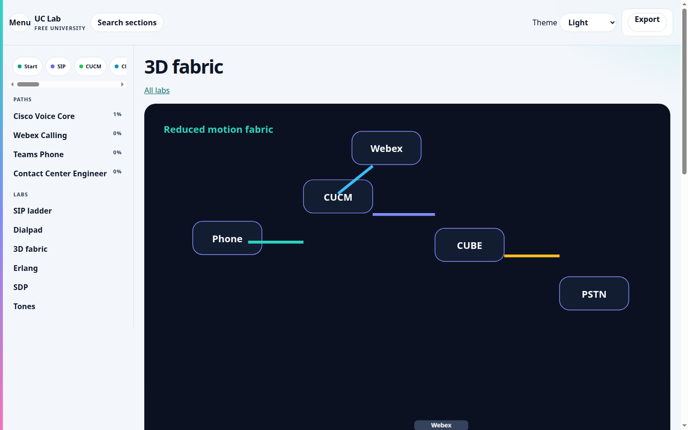
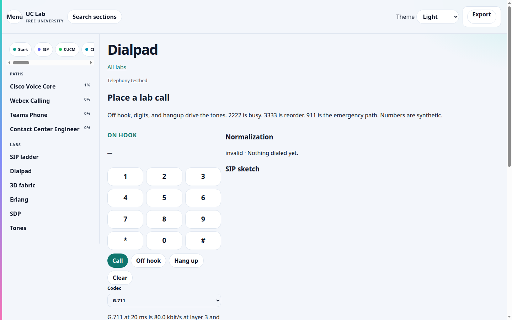
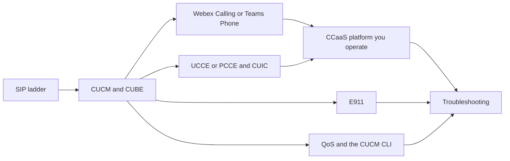

# UC Lab Free University

An independent student campus for enterprise voice, unified communications, and contact center. Open it in the browser, or download the zip and read it offline.

<!-- cml-badges:start -->

&nbsp;

&nbsp;

&nbsp;

&nbsp;

&nbsp;

&nbsp;

<!-- cml-badges:end -->

## Contents

| Kind | Document | Size |
|---|---|---:|
| Cheat sheet | [Call flows](./flagship/cheats/call-flows.pdf) | 78.3 KB |
| Cheat sheet | [Configuration](./flagship/cheats/config.pdf) | 79.1 KB |
| Cheat sheet | [E911](./flagship/cheats/e911.pdf) | 78.8 KB |
| Cheat sheet | [Firewall](./flagship/cheats/firewall.pdf) | 79.8 KB |
| Cheat sheet | [Flashcards](./flagship/cheats/flashcards.pdf) | 90.8 KB |
| Cheat sheet | [Glossary](./flagship/cheats/glossary.pdf) | 79.8 KB |
| Cheat sheet | [Migration](./flagship/cheats/migration.pdf) | 77.6 KB |
| Cheat sheet | [Ports](./flagship/cheats/ports.pdf) | 79.5 KB |
| Cheat sheet | [PSTN](./flagship/cheats/pstn.pdf) | 79.1 KB |
| Cheat sheet | [QoS](./flagship/cheats/qos.pdf) | 79.5 KB |
| Cheat sheet | [Security](./flagship/cheats/security.pdf) | 79.1 KB |
| Cheat sheet | [Troubleshooting](./flagship/cheats/troubleshoot.pdf) | 78.2 KB |
| Cheat sheet | [WFM and recording](./flagship/cheats/wfm-recording.pdf) | 78.4 KB |
| Topic note | [CUBE and SBC](./flagship/downloads/cube-sbc.pdf) | 45.2 KB |
| Topic note | [CUCM dial plan](./flagship/downloads/cucm-dial-plan.pdf) | 48.3 KB |
| Topic note | [CUCM and Webex migration](./flagship/downloads/cucm-webex-migration.pdf) | 43.2 KB |
| Topic note | [E911 design](./flagship/downloads/e911-design.pdf) | 49.9 KB |
| Topic note | [QoS and DSCP](./flagship/downloads/qos-dscp.pdf) | 45.3 KB |
| Topic note | [SDP offer and answer](./flagship/downloads/sdp-offer-answer.pdf) | 47.5 KB |
| Topic note | [SIP call flows](./flagship/downloads/sip-call-flows.pdf) | 50.8 KB |
| Briefing | [Enterprise voice deck](./downloads/Enterprise-Voice-with-Cisco-Technologies-CC-Cloud-Migration.pptx) | 5.0 MB |
| Campus | [HTML zip](./releases/uc-lab-free-university.html.zip) | 4.3 MB |

Educational independent student project. Not affiliated with or endorsed by Cisco or any vendor. Trademarks belong to their owners.

Cypher Monkey Labs © 2026 CypherMonkeyLabs

The flagship studio is the repository root [index.html](./index.html): call-flow ladders, the diagram atlas, charts, cheat codes, and an offline zip. The same studio also lives at [flagship/index.html](./flagship/index.html). The 580-section campus below is the deep library.

The shell is a few kilobytes. Lessons load one at a time: CUCM, CUBE, SIP, Webex Calling, Webex Contact Center, Teams Phone, UCCE, PCCE, CUIC, the main CCaaS platforms, E911, QoS, and the troubleshooting habit that ties them together. Version 21. No account, no install, no CDN. Open the HTML and keep `assets`, `sw.js`, and `manifest.webmanifest` beside it.

  

## Tracks

| Track | Sections | You can do this when you finish |
|---|---:|---|
| Start here | 6 | Explain a call with leg, identifier, counter, and capture |
| SIP and media | 9 | Read a ladder and separate signaling from RTP |
| CUCM and CUBE | 12 | Trace CSS, route pattern, dial-peer, and the SIP trunk |
| Webex Calling and Teams Phone | 121 | Choose Calling Plan, Operator Connect, Direct Routing, or a local gateway, then prove it |
| Contact center — UCCE and PCCE | 6 | Trace ingress, CVP, script, queue, Finesse, and CUIC |
| CCaaS and UCaaS platforms | 105 | Follow a contact on Webex CC, Connect, Genesys, NICE, Five9, Flex, and the platforms you still meet |
| Emergency calling | 3 | Prove location, ELIN or ERL, and the on-site notification |
| Voice network and QoS | 16 | Mark and measure EF, use the CUCM CLI, and explain WebRTC only for browser agents |
| Migrations | 61 | Dual-run a number, rehearse rollback, and leave evidence |
| Troubleshooting | 112 | One hypothesis, one change, one evidence pack |
| Evidence habits | 33 | Write the proof before you touch production |
| Design notes | 35 | Read capacity, identity, recording, and failure domains |
| Practice | 56 | Drill the same faults without a customer on the line |
| Reference | 5 | Open the glossary and the official-doc index |

580 sections. The old bulk practicums, trading-turret track, Asterisk course, and generic machine-learning chapter are not in this edition.

## Paths and labs

The same 580 sections sit on four certification paths. Opened and completed lessons stay in this browser.

| Path | Sections |
|---|---:|
| Cisco Voice Core | 314 |
| Webex Calling | 69 |
| Teams Phone | 67 |
| Contact Center Engineer | 130 |

Shared foundations stay on Cisco Voice Core. Webex Calling, Teams Phone, and Contact Center Engineer are the specialist trails.

| Lab | What you do |
|---|---|
| SIP ladder | Play, pause, step, and inspect a call |
| Dialpad | Off hook, digits, busy (`2222`), reorder (`3333`), `911`, codec choice, WebAudio tones |
| 3D fabric | Phone, CUCM, CUBE, PSTN, and Webex Calling, with link-failure toggles |
| Erlang and SDP | Erlang B/C staffing model, and a line-by-line SDP reader |
| Tone bench | The 35 generated clips, on the campus orientation lesson |

RFC numbers in the lesson text link to the RFC Editor. Each lesson lists the Cisco, Webex, Microsoft, or ITU document for that path. Question CSV and Markdown exports run in a Web Worker. Print covers the open lesson. **Save lessons offline** fills the service-worker cache when the campus is served over http.

  

  

### Page weight

Measured on this tree. Lighthouse is mobile, simulated throttling, against the local campus.

| | Before | After |
|---|---:|---:|
| HTML | 14,614,915 bytes | 4,092 bytes |
| First load | about 19.5 MB with the flow catalog | 323,006 bytes (shell, CSS, app, catalog index) |
| Home DOM | every section in one document | 229 elements, one `h1` |
| Lighthouse, home | | performance 91, accessibility 100 |
| Lighthouse, Webex lesson | | performance 84, accessibility 100 |

The 580 section modules are 16,480,344 bytes and load one lesson at a time. A practice bank shows six cards at a time (Teams Phone: 6 of 400, 517 elements). Three.js (691,648 bytes, vendored) loads only on the 3D fabric.

## Study order

## Visual studio

Each of the 580 sections opens with its own step-through flow, plus a failure path in the scenario menu. The original lessons keep their message names, ports, headers, and timers. Each added Webex Calling and Teams Phone lesson adds a success ladder, a failure ladder, a lab, and a cited quiz. Play, pause, step, and speed sit on the diagram. The current message is highlighted and the caption says what the step means. A track map and local achievement badges sit above the player. Nothing in those badges is a name or an address; the browser only stores section ids you opened. Topology, console, and capture tabs are drawn from that section's flow. Twenty-six longer walkthroughs, plus the campus home, play as scenes. Charts are thirty-two different formulas, not one chart reused under new titles. The tone bench is generated in the browser with WebAudio.

Counts are distinct definitions, not placements:

| Kind | Count |
|---|---:|
| Sections | 580 |
| Distinct flow definitions | 1,197 |
| Walkthrough scenes | 38 |
| Chart types | 32 |
| Distinct illustrations (topology, console, and capture specs) | 3,396 |
| Audio clips | 35 |
| Track hubs | 14 |

Codec bandwidth is `(payload + 40 + L2) × 8 × (1000 / ptime) / 1000`. G.711 at 20 ms is 80 kbit/s at layer 3 and 87.2 kbit/s with an 18-byte Ethernet header. MOS is a short form of ITU-T G.107, labeled as a teaching model. Erlang B and Erlang C use the standard iterative forms. The delay chart sums packetization, queuing, serialization, propagation, and jitter buffer against the 150 ms G.114 planning limit.

  

  

  

  

## Open it

1. **Download (v21):** [releases/uc-lab-free-university.html.zip](./releases/uc-lab-free-university.html.zip)
2. Unzip. You get `uc-lab-free-university.html`, `sw.js`, `manifest.webmanifest`, and an `assets` folder. Leave them side by side.
3. **Open** the HTML in Chrome, Safari, Edge, or Firefox. From this repo, the same campus is [campus/uc-lab-free-university.html](./campus/uc-lab-free-university.html).

`file://` opens the shell and any lesson you navigate to. Served over http, including GitHub Pages, the service worker caches the shell for the next visit. Old hashes still open a lesson: `#prod-cucm` and `#/lesson/prod-cucm`.

Desktop is the comfortable way to read it. Under 640px the path list moves behind **Menu** and a bottom nav stays on screen. In-app browsers from chat apps are a poor place to open the zip.

| Also in the repo | What it is |
|---|---|
| [63-slide briefing](./downloads/Enterprise-Voice-with-Cisco-Technologies-CC-Cloud-Migration.pptx) | Enterprise voice, contact center, and cloud migration |
| [How to get the file](./HOW-TO-GET.md) | Phone and desktop steps |
| [Start here](./START-HERE.md) | First hour |
| [How to use it](./docs/HOW-TO-USE.md) | A 30-day path, interview prep, and a class plan |
| [FAQ](./docs/FAQ.md) | What this is, and what it is not |
| [Session vault, Oct 2026](./docs/references/uc-contact-center-session-vault-2026-10.md) | Public conference and doc links |

## Two topics that look out of place

**WebRTC** stays because contact-center agent desktops and web soft clients send media from the browser. It is not a separate product track.

**Linux** stays as the CUCM command line. CUCM, Unity Connection, IM and Presence, and Emergency Responder run on Cisco VOS. You use that shell to check NTP, replication, certificates, and disk. It is not a Linux administration course.

## Proof habit

| Letter | Meaning | Question |
|---|---|---|
| L | Leg | Which hop failed? |
| I | Identifier | Which Call-ID, RouterCallKey, or interaction id joins the logs? |
| C | Counter | Which platform counter moved? |
| C | Capture | Which ladder, packet capture, CLI output, or CUIC interval proves it? |

## Settings, themes, and tips

**Settings** stores the choice in this browser: light, dark, high contrast, and signal (amber on charcoal); sound effects; narration with a voice list and a speed control; reduced motion; and font size. Narration stays off until you turn it on, and a robotic Microsoft Edge voice is not selected for you. **Tips and traps** (`#/tips`) is a pro-tip, interview-trap, and cheat-sheet page for each of the 14 tracks.

The default page is slate paper (`#F3F6FB`), indigo, and teal, with amber and rose as secondary marks. Primary buttons use `#0F766E` with light text. The 3D stage and ladder inspect panel use navy `#0B1120`.

  

  

Nothing is loaded from a CDN.

## Content carried over from the v23 single-file edition

The modular app includes the v23 call flows (conference, CTI route point, courtesy callback, park, shared line, voicemail forward, early offer, T.38 fax, pickup, single number reach, trunk failover), eight fault drills, and 2,018 term cards with 164 situations and a 24-question cross-track exam. They live in the SIP drill bank, the mastery card library, and the walkthrough list. `scripts/port-main-v23-content.py` records that port.

The interactive shell that conflict resolution dropped is back as lazy modules. Open **Labs**. The quiz bank and the lab scripts stay off the first load.

| Lab | What you do | Why it is here |
|---|---|---|
| Call flow | Step through 24 ladders. Nine of them were not in the modular walk list: hold, blind transfer, consult transfer, hunt, MRA, IVR to agent, E911, Teams Direct Routing, and Webex Contact Center | A 200 OK is not two-way audio |
| Dial plan | Place the CSS, partition, pattern, list, group, and trunk into order | A missing partition means the outside number does not exist for that phone |
| IVR | Drag nodes, connect a digit, and place a test call | A prompt is not a queue |
| SIP decode | Paste a message or click a header | A header is a job |
| Codec | Turn payload, packetization, and layer-2 bytes into kbit/s | G.711 on the wire is more than 64 kbit/s |
| Jitter | Move loss and jitter and watch arrivals | A jitter buffer hides variation by adding delay |
| Route | Pick a directory number and trace CSS and partition order | If 9.@ is searched before 911, emergency takes the PSTN route |
| Webex PSTN | Name a location and the PSTN model | Calling Plan has no local gateway |
| UCCE | Follow a dialed number into a call type and skill group | The call type is the report bucket |
| Finesse | Walk ready, reserved, talking, and wrap | The router sees the desktop state |
| E911 | Order discovery, mapping, callback, route, notify, and proof | A connected call with the wrong location is a failed emergency call |
| QoS | Mark RTP, SIP, and bulk, then pick the queue | EF without a priority queue is a label |
| SRTP | Step a teaching TLS and SRTP flight | TLS locks signaling. SRTP locks audio |
| Erlang | Estimate staff from calls per hour and handle time | The figure is a teaching formula |
| Find fault | Pick the next proof for a named symptom | A second guess without evidence is not a finding |
| Dial-peer | Match a called number on CUBE | Longest match, then the lowest preference |
| One-way | Read an SDP address the far side cannot reach | The ladder can be perfect while RTP is not |
| Record | Choose where the PSTN fork belongs | A report is not the audio |
| Quiz | Ten questions from a track bank of at least 150, with a reason that is not a copy of the choice | The score is stored per track in this browser |
| Cards | Flip one of 2,018 terms | The back says why you would use it |
| Boss | Sit the cross-track exam | Eighty percent is the pass line |

The quiz bank is 2,913 questions: at least 150 scored questions on each of the 14 tracks. Each of the 2,018 facts is asked once. A second question appears only when the reason adds a further consequence (731 of those), and 164 questions are situations. The boss exam is 24 questions. Flashcards are 2,018.

| Track | Questions |
|---|---|
| Start here | 169 |
| SIP and media | 194 |
| CUCM and CUBE | 185 |
| Webex Calling and Teams Phone | 243 |
| Contact center — UCCE and PCCE | 197 |
| CCaaS and UCaaS platforms | 298 |
| Emergency calling | 163 |
| Voice network and QoS | 160 |
| Migrations | 188 |
| Troubleshooting | 257 |
| Evidence habits | 267 |
| Design notes | 171 |
| Practice | 162 |
| Reference | 259 |

Per-track quiz score, known cards, and the boss result stay in `localStorage`. No name, number, or capture is stored. The labs are teaching models. They do not change a live system. Curriculum counts stay 580 sections, 1,197 flows, and 15,972 details.

## License

Educational material under the [MIT license](./LICENSE). Not an official Cisco, Microsoft, Google, Amazon, or Genesys publication. Check the vendor's current document before you change production.

Cypher Monkey Labs © 2026 CypherMonkeyLabs
