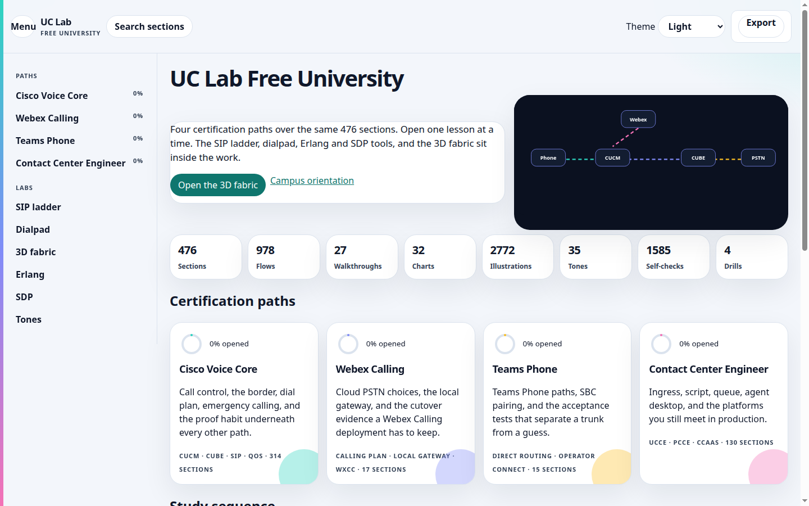
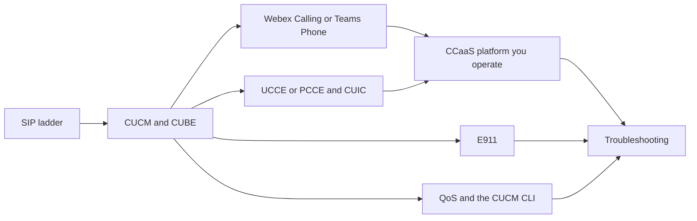
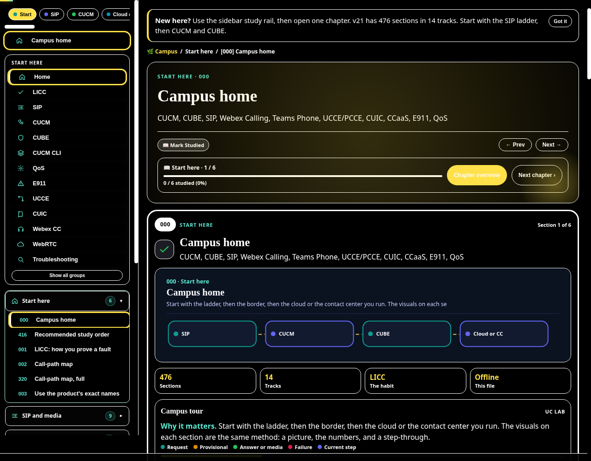
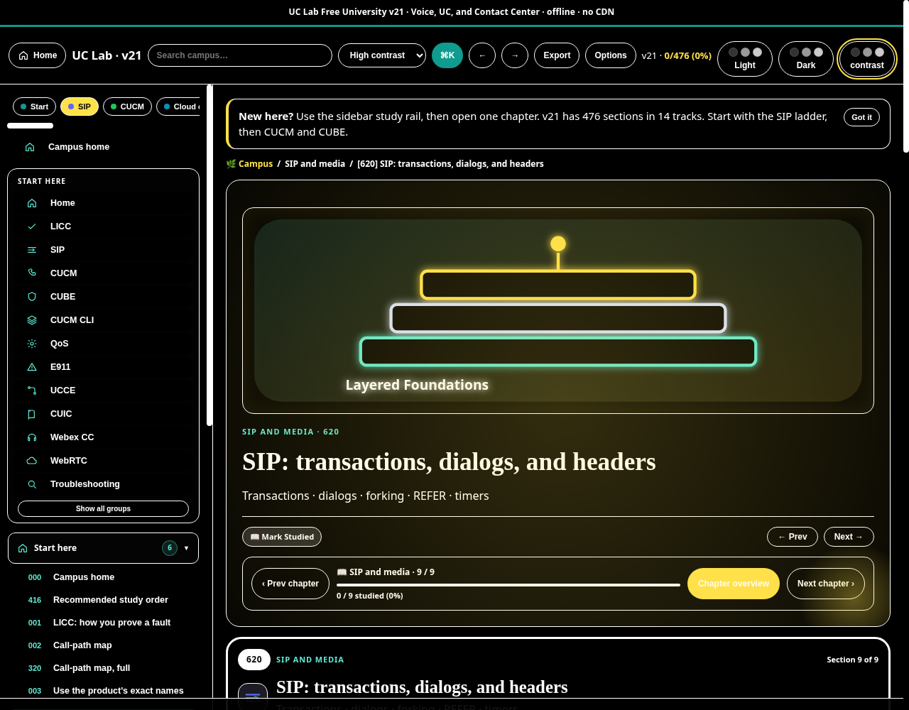
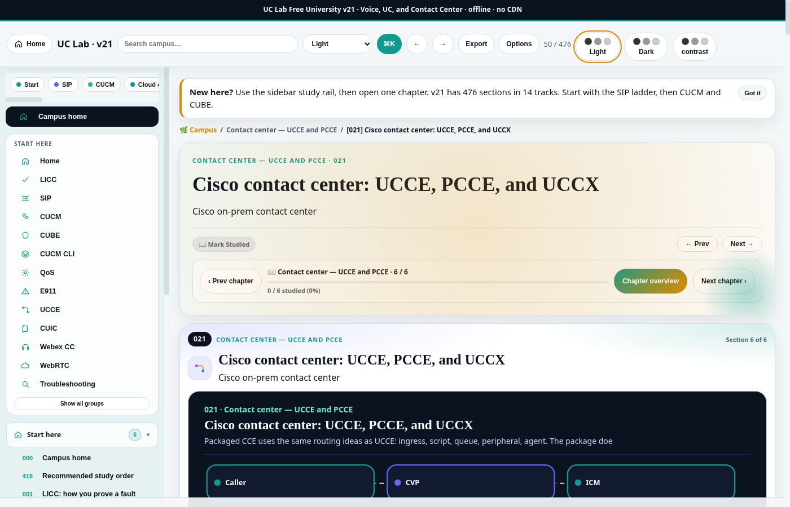
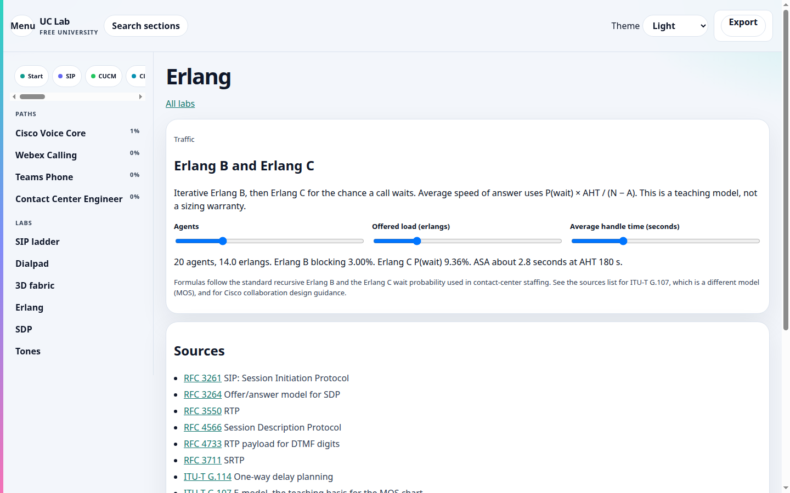
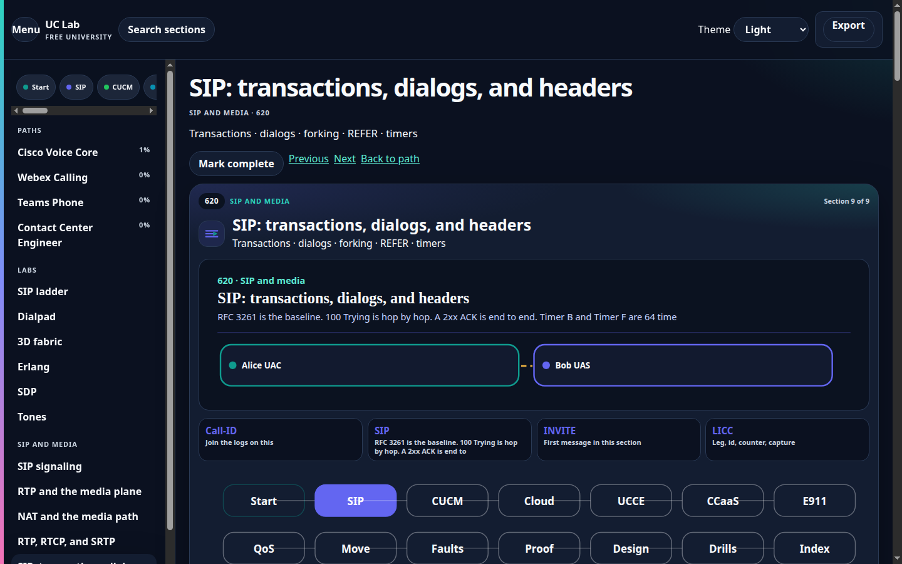
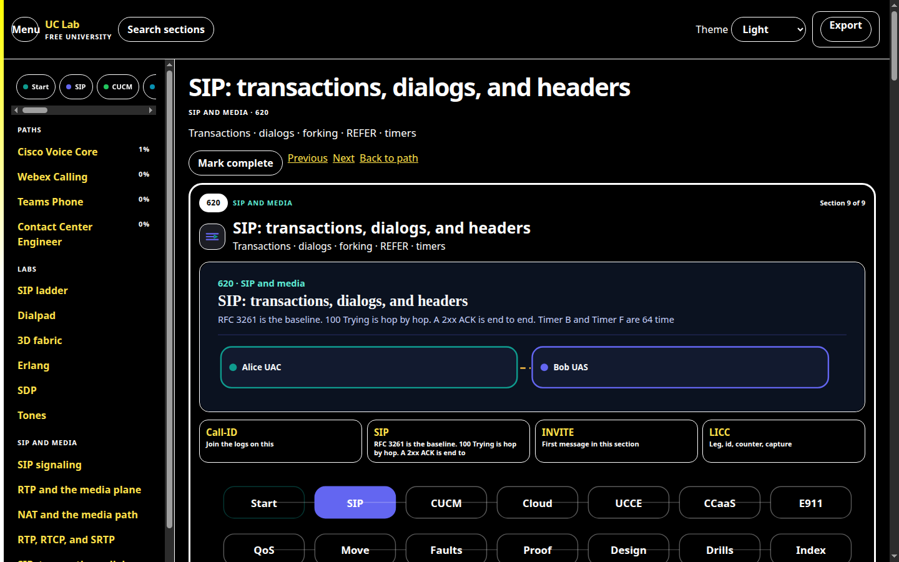

  

  
  &nbsp;
  

A free offline campus for people who run **voice, unified communications, and contact center** systems. The file is the course: CUCM, CUBE, SIP, Webex Calling, Webex Contact Center, Teams Phone, UCCE, PCCE, CUIC, the main CCaaS platforms, E911, QoS, and the troubleshooting habit that ties them together.

Built by **CYPHER0X9**, a voice and UC engineer. Version **21**. No account, no install, no CDN. Open the HTML and keep the `assets` folder beside it.

  

## Tracks

| Track | Sections | You can do this when you finish |
|---|---:|---|
| Start here | 6 | Explain a call with leg, identifier, counter, and capture |
| SIP and media | 9 | Read a ladder and separate signaling from RTP |
| CUCM and CUBE | 12 | Trace CSS, route pattern, dial-peer, and the SIP trunk |
| Webex Calling and Teams Phone | 17 | Choose Calling Plan, Operator Connect, Direct Routing, or a local gateway, then prove it |
| Contact center — UCCE and PCCE | 6 | Trace ingress, CVP, script, queue, Finesse, and CUIC |
| CCaaS and UCaaS platforms | 105 | Follow a contact on Webex CC, Connect, Genesys, NICE, Five9, Flex, and the platforms you still meet |
| Emergency calling | 3 | Prove location, ELIN or ERL, and the on-site notification |
| Voice network and QoS | 16 | Mark and measure EF, use the CUCM CLI, and explain WebRTC only for browser agents |
| Migrations | 61 | Dual-run a number, rehearse rollback, and leave evidence |
| Troubleshooting | 112 | One hypothesis, one change, one evidence pack |
| Evidence habits | 33 | Write the proof before you touch production |
| Design notes | 35 | Read capacity, identity, recording, and failure domains |
| Practice | 56 | Drill the same faults without a customer on the line |
| Reference | 5 | Open the glossary and the official-doc index |

476 sections in the sidebar. The old bulk practicums, trading-turret track, Asterisk course, and generic machine-learning chapter are not in this edition.

## Study order

## Visual studio

Each of the 476 sections opens with its own step-through flow: real message names, ports, headers, and timers for that section, plus a failure path in the scenario menu. Play, pause, step, and speed sit on the diagram. The current message is highlighted and the caption says what the step means. A track map and local achievement badges sit above the player. Nothing in those badges is a name or an address; the browser only stores section ids you opened. Topology, console, and capture tabs are drawn from that section's flow. Twenty-six longer walkthroughs, plus the campus home, play as scenes. Charts are thirty-two different formulas, not one chart reused under new titles. The tone bench is generated in the browser with WebAudio.

Counts are distinct definitions, not placements:

| Kind | Count |
|---|---:|
| Sections | 476 |
| Distinct flow definitions | 978 |
| Walkthrough scenes | 27 |
| Chart types | 32 |
| Distinct illustrations (topology, console, and capture specs) | 2,772 |
| Audio clips | 35 |
| Track hubs | 14 |

Codec bandwidth is `(payload + 40 + L2) × 8 × (1000 / ptime) / 1000`. G.711 at 20 ms is 80 kbit/s at layer 3 and 87.2 kbit/s with an 18-byte Ethernet header. MOS is a short form of ITU-T G.107, labeled as a teaching model. Erlang B and Erlang C use the standard iterative forms. The delay chart sums packetization, queuing, serialization, propagation, and jitter buffer against the 150 ms G.114 planning limit.

  

  

  

  

## Open it

1. **Download (v21):** [releases/uc-lab-free-university.html.zip](./releases/uc-lab-free-university.html.zip)
2. Unzip. You get `uc-lab-free-university.html` and an `assets` folder. Leave them side by side.
3. **Open** the HTML in Chrome, Safari, Edge, or Firefox. From this repo, the same campus is [campus/uc-lab-free-university.html](./campus/uc-lab-free-university.html).

Desktop is the comfortable way to read it. A phone works in the full browser app after the file loads. In-app browsers from chat apps often fail on a file this size.

| Also in the repo | What it is |
|---|---|
| [62-slide briefing](./downloads/Enterprise-Voice-with-Cisco-Technologies-CC-Cloud-Migration.pptx) | Enterprise voice, contact center, and cloud migration |
| [How to get the file](./HOW-TO-GET.md) | Phone and desktop steps |
| [Start here](./START-HERE.md) | First hour |
| [How to use it](./docs/HOW-TO-USE.md) | A 30-day path, interview prep, and a class plan |
| [FAQ](./docs/FAQ.md) | What this is, and what it is not |
| [Session vault, Oct 2026](./docs/references/uc-contact-center-session-vault-2026-10.md) | Public conference and doc links |

## Two topics that look out of place

**WebRTC** stays because contact-center agent desktops and web soft clients send media from the browser. It is not a separate product track.

**Linux** stays as the CUCM command line. CUCM, Unity Connection, IM and Presence, and Emergency Responder run on Cisco VOS. You use that shell to check NTP, replication, certificates, and disk. It is not a Linux administration course.

## Proof habit

| Letter | Meaning | Question |
|---|---|---|
| L | Leg | Which hop failed? |
| I | Identifier | Which Call-ID, RouterCallKey, or interaction id joins the logs? |
| C | Counter | Which platform counter moved? |
| C | Capture | Which ladder, packet capture, CLI output, or CUIC interval proves it? |

## Light, dark, and high contrast

The palette is teal `#0F9B8E` and indigo `#6366F1` on navy `#0B1220`, with green `#22C55E` and amber for media and warnings. The header theme control switches light, dark, and high contrast.

  

  

Nothing is loaded from a CDN.

## App shell

The same file now opens like a campus app. The home page is a dashboard: track cards tilt as you move across them, counters settle on the real totals, and a progress ring reads only the section ids this browser has opened.

Ctrl+K searches every lesson. Light and dark stay in the header. Moving between sections fades the page. A tone you play stays in a bar at the bottom so you can keep reading.

Labs, from the header or the home page. There are 21. Each lesson has a **Try it** button that opens the lab that matches that page.

| Lab | What you do | Why it is here |
|---|---|---|
| Call flow | Place one of 24 calls, including transfer, conference, hunt, CTI route point, MRA, trunk failover, IVR to agent, and callback | A 200 OK is not two-way audio |
| Dial plan | Drag the CSS, partition, pattern, list, group, and trunk into order | A missing partition means the outside number does not exist for that phone |
| IVR | Drag nodes, connect a digit, and place a test call | A prompt is not a queue |
| SIP decode | Paste a message or click a header | A header is a job |
| Codec | Turn payload, packetization, and layer-2 bytes into kbit/s | G.711 on the wire is more than 64 kbit/s |
| Jitter | Move loss and jitter and watch arrivals | A jitter buffer hides variation by adding delay |
| Route | Pick a directory number and trace CSS and partition order | If 9.@ is searched before 911, emergency takes the PSTN route |
| Webex PSTN | Name a location and the PSTN model | Calling Plan has no local gateway |
| UCCE | Follow a dialed number into a call type and skill group | The call type is the report bucket |
| Finesse | Walk ready, reserved, talking, and wrap | The router sees the desktop state |
| E911 | Order discovery, mapping, callback, route, notify, and proof | A connected call with the wrong location is a failed emergency call |
| QoS | Mark RTP, SIP, and bulk, then pick the queue | EF without a priority queue is a label |
| SRTP | Step a teaching TLS and SRTP flight | TLS locks signaling. SRTP locks audio |
| Erlang | Estimate staff from calls per hour and handle time | The figure is a teaching formula |
| Find fault | Pick the next proof for a named symptom | A second guess without evidence is not a finding |
| Dial-peer | Match a called number on CUBE | Longest match, then the lowest preference |
| One-way | Read an SDP address the far side cannot reach | The ladder can be perfect while RTP is not |
| Record | Choose where the PSTN fork belongs | A report is not the audio |
| Quiz | Ten questions from a track bank of at least 150, with a reason that is not a copy of the choice | The score is stored per track in this browser |
| Cards | Flip one of 2,018 terms | The back says why you would use it |
| Boss | Sit the cross-track exam | Eighty percent is the pass line |

The quiz bank is 2,913 questions: at least 150 scored questions on each of the 14 tracks. Each of the 2,018 facts is asked once. A second question appears only when the reason adds a further consequence (731 of those), and 164 questions are situations. The boss exam is 24 questions. Flashcards are 2,018.

| Track | Questions |
|---|---|
| Start here | 169 |
| SIP and media | 194 |
| CUCM and CUBE | 185 |
| Webex Calling and Teams Phone | 243 |
| Contact center — UCCE and PCCE | 197 |
| CCaaS and UCaaS platforms | 298 |
| Emergency calling | 163 |
| Voice network and QoS | 160 |
| Migrations | 188 |
| Troubleshooting | 257 |
| Evidence habits | 267 |
| Design notes | 171 |
| Practice | 162 |
| Reference | 259 |

Progress, per-track quiz score, known cards, badges, and the study streak stay in `localStorage`. No name, number, or capture is stored. The labs are teaching models. They do not change a live system.

## License

Educational material under the [MIT license](./LICENSE). Not an official Cisco, Microsoft, Google, Amazon, or Genesys publication. Check the vendor's current document before you change production.

**CYPHER0X9** · [github.com/cipher0x9](https://github.com/cipher0x9)
